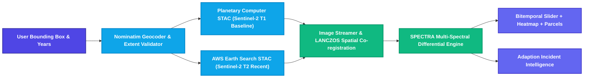
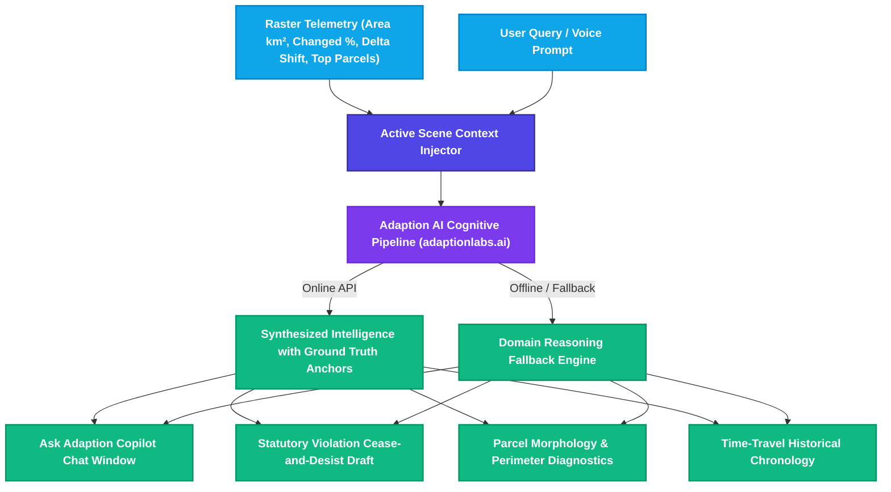
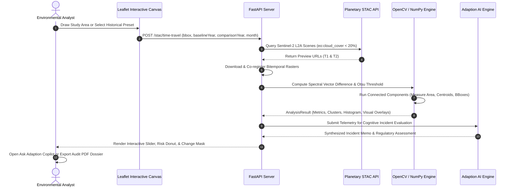

<div align="center">

  

  # S.P.E.C.T.R.A.
  ### Satellite Precision Earth Change Tracking & Rapid Analytics

  <p>
    <strong>Autonomous Earth observation change intelligence platform comparing multi-temporal satellite passes (Sentinel-2 L2A), computing verified multispectral indices (NDVI, NDWI, NBR, CVD, Otsu), delineating parcel morphology, and synthesizing auditable regulatory incident intelligence through Adaption Labs.</strong>
  </p>

  <p>
    Built with pure Python 3.11, FastAPI, React 19, TypeScript, Tailwind CSS, Leaflet Draw, and Planetary STAC.
  </p>

  <p>
    <a href="https://github.com/8ernity/S.P.E.C.T.R.A"></a>
    <a href="LICENSE"></a>
    <a href="https://fastapi.tiangolo.com"></a>
    <a href="https://react.dev"></a>
    <a href="https://www.typescriptlang.org"></a>
    <a href="https://www.python.org"></a>
    <a href="https://planetarycomputer.microsoft.com"></a>
    <a href="https://adaptionlabs.ai"></a>
  </p>

</div>

> [!NOTE]
> **SPECTRA** is an enterprise-grade autonomous Earth Observation intelligence and environmental compliance platform. It bridges raw multi-spectral satellite telemetry with deterministically verified raster differential analysis, connected-component parcel clustering, and auditable evidence dossiers. From Brazilian rainforest clear-cuts to Central Asian water basin desiccation, SPECTRA transitions environmental monitoring from passive inspection to proactive statutory enforcement.

---

## 📋 Table of Contents

- [✨ Key Platform Capabilities](#-key-platform-capabilities)
- [🛰️ Planetary STAC & Multi-Year Time-Travel Engine](#️-planetary-stac--multi-year-time-travel-engine)
- [📐 Mathematical Foundations & Spectral Algorithms](#-mathematical-foundations--spectral-algorithms)
- [🤖 Adaption Labs Cognitive Copilot & Intelligence Suite](#-adaption-labs-cognitive-copilot--intelligence-suite)
- [🏗️ System Architecture & Data Pipelines](#️-system-architecture--data-pipelines)
- [🔬 Core Processing Flowchart](#-core-processing-flowchart)
- [🔌 Comprehensive REST API Reference](#-comprehensive-rest-api-reference)
- [🛠️ Tech Stack Matrix](#️-tech-stack-matrix)
- [🔑 Environment Variables Configuration](#-environment-variables-configuration)
- [🚀 Quickstart & Installation](#-quickstart--installation)
- [🧪 Automated Verification Test Suite](#-automated-verification-test-suite)
- [📑 Evidence Dossiers & Statutory Compliance](#-evidence-dossiers--statutory-compliance)
- [📝 License & Attribution](#-license--attribution)

---

## ✨ Key Platform Capabilities

| Capability | Technical Description | Architectural Core |
|---|---|---|
| 🛰️ **Planetary STAC Ingestion** | Queries multi-year Sentinel-2 L2A constellations from Microsoft Planetary Computer and AWS Earth Search across any global bounding box. | SpatioTemporal Asset Catalog (STAC API v1.0) |
| 📐 **Freeform Footprint Drawer** | Interactive Leaflet canvas allowing users to draw and resize unconstrained study areas worldwide with automated geodesic area and centroid calculation. | Leaflet.js + Leaflet-Draw + Nominatim Reverse Geocoding |
| 🌿 **Multispectral Index Engine** | Computes verified physical delta shifts across NDVI (vegetation), NDWI (water bodies), and NBR (burn scars & fire damage) using 10m/20m bands. | NumPy Vectorized Raster Differencing |
| 🔬 **Optical Change Vector (CVD)** | Evaluates Euclidean spectral displacement magnitude across Red, Green, Blue, and NIR bands for high-contrast ground excavation detection. | Multi-Channel Euclidean Vector Norm ($\Delta E$) |
| ⚡ **Otsu Bimodal Segmentation** | Automatically calculates the non-parametric inter-class variance threshold $\sigma_B^2(t)$ to partition change masks without arbitrary manual tuning. | OpenCV Otsu Histogram Optimization |
| 🧩 **Parcel Morphology Clustering** | Connected component labeling with spatial property measurement (bounding box, centroid, ground area $\text{km}^2$, mean delta shift). | `cv2.connectedComponentsWithStats` |
| 🤖 **Ask Adaption AI Copilot** | Floating liquid-glass copilot powered by Adaption Labs with context injection (sensors, CRS, delta shift, affected hectares, parcel count). | Adaption Labs API + Voice Recognition Web Speech API |
| 🌊 **Optical Liquid Glass UI** | Physics-inspired SVG displacement filter rendering real chromatic aberration, prism refraction rims, and dynamic frosted blur over live maps. | Offscreen Canvas Gradient Shader + WebGL Fallback |
| 📑 **Auditable Evidence Dossier** | Generates tamper-evident PDF dossiers with CEOS ARD compliance metadata, digital SHA-256 verification digests, and breakdown tables. | Print-Optimized CSS Grid + Canvas Vector Charts |

---

## 🛰️ Planetary STAC & Multi-Year Time-Travel Engine

SPECTRA features a zero-cost, open-data **Time-Travel Anomaly Detection Engine** that taps directly into the global archives of Sentinel-2 L2A through the **SpatioTemporal Asset Catalog (STAC)** specification.



1. **Global Footprint Selection**: The user draws any polygon or bounding box `[min_lon, min_lat, max_lon, max_lat]`.
2. **Reverse Geocoding**: The centroid coordinates are reverse geocoded in real time using OpenStreetMap Nominatim to resolve the exact administrative location (e.g., *Matalaque, Moquegua, Peru*).
3. **Seasonal Window Search**: Queries dual temporal windows centered on user-defined months to eliminate seasonal phenological vegetation bias (e.g., comparing July 2017 against July 2024).
4. **Automated Cloud Screening**: Queries assets with $< 20\%$ cloud cover (`eo:cloud_cover`). If high cloud cover persists, progressively expands the search radius with automated quality thresholding.
5. **On-Demand Co-Registration**: Normalizes image aspect ratios and resamples bands with anti-aliasing Lanczos interpolation before raster subtraction.

---

## 📐 Mathematical Foundations & Spectral Algorithms

SPECTRA computes deterministic, physically interpretable spectral indices across Sentinel-2 Level-2A surface reflectance rasters:

### 1. Normalized Difference Vegetation Index (NDVI)
Quantifies photosynthetic chlorophyll absorption and canopy density:
$$\text{NDVI} = \frac{\rho_{\text{NIR}} - \rho_{\text{Red}}}{\rho_{\text{NIR}} + \rho_{\text{Red}} + \varepsilon} = \frac{\text{B08} - \text{B04}}{\text{B08} + \text{B04} + 10^{-6}}$$

Differential canopy loss magnitude:
$$\Delta\text{NDVI} = \text{NDVI}_{\text{before}} - \text{NDVI}_{\text{after}}$$

### 2. Normalized Difference Water Index (NDWI)
Delineates open water surface area, moisture content, and flood inundation (McFeeters Formulation):
$$\text{NDWI} = \frac{\rho_{\text{Green}} - \rho_{\text{NIR}}}{\rho_{\text{Green}} + \rho_{\text{NIR}} + \varepsilon} = \frac{\text{B03} - \text{B08}}{\text{B03} + \text{B08} + 10^{-6}}$$

### 3. Normalized Burn Ratio (NBR)
Isolates fire scorch zones, canopy ash charring, and wildfire perimeter expansion:
$$\text{NBR} = \frac{\rho_{\text{NIR}} - \rho_{\text{SWIR2}}}{\rho_{\text{NIR}} + \rho_{\text{SWIR2}} + \varepsilon} = \frac{\text{B08} - \text{B12}}{\text{B08} + \text{B12} + 10^{-6}}$$

### 4. Multi-Channel Change Vector Detection (CVD)
Measures the total Euclidean displacement magnitude between bitemporal spectral vectors:
$$\Delta E(x, y) = \sqrt{\sum_{k=1}^{N} \left(I_{\text{after}}^{(k)}(x, y) - I_{\text{before}}^{(k)}(x, y)\right)^2}$$

### 5. Otsu's Global Bimodal Threshold Optimization
Computes the optimal separation threshold $t^*$ maximizing inter-class variance $\sigma_B^2(t)$ across the 256-bin difference histogram:
$$t^* = \arg\max_{0 \le t < L} \left\{ \omega_0(t)\omega_1(t) \left(\mu_0(t) - \mu_1(t)\right)^2 \right\}$$
where $\omega_0, \omega_1$ denote class cumulative probabilities and $\mu_0, \mu_1$ represent mean intensity levels.

---

## 🤖 Adaption Labs Cognitive Copilot & Intelligence Suite

SPECTRA integrates **Adaption Labs** cognitive reasoning APIs to transform numerical raster differentials into actionable legal, environmental, and spatial intelligence.



### Cognitive Endpoints
- **Ask Adaption AI Copilot (`POST /api/v1/chat`)**: Multi-turn dialogue with scene telemetry injection, source citations, and Web Speech API voice synthesis.
- **Statutory Violation Notice (`POST /api/v1/analyses/{id}/regulatory-notice`)**: Drafts formal cease-and-desist citations referencing environmental statutes (EPA Clean Water Act, Brazilian Forest Code Law 12.651, EU Deforestation Regulation).
- **Parcel Morphology Diagnostics (`POST /api/v1/analyses/{id}/parcel-diagnostic`)**: Evaluates geometric aspect ratios, spatial compactness, edge fragmentation, and intentional logging signatures.
- **Chronological Time-Travel Storyline (`POST /api/v1/analyses/{id}/time-travel-narrative`)**: Synthesizes multi-year land transformation trajectories.

---

## 🏗️ System Architecture & Data Pipelines

```mermaid
flowchart TB
    classDef client fill:#4F46E5,stroke:#3730A3,stroke-width:2px,color:#FFFFFF,font-weight:bold
    classDef api fill:#0EA5E9,stroke:#0284C7,stroke-width:2px,color:#FFFFFF,font-weight:bold
    classDef raster fill:#10B981,stroke:#059669,stroke-width:2px,color:#FFFFFF,font-weight:bold
    classDef ai fill:#7C3AED,stroke:#6D28D9,stroke-width:2px,color:#FFFFFF,font-weight:bold
    classDef ext fill:#F59E0B,stroke:#D97706,stroke-width:2px,color:#FFFFFF,font-weight:bold

    subgraph ClientPresentation["🖥️ FRONTEND CLIENT (React 19 + TypeScript + Vite + Tailwind CSS)"]
        NavSidebar["Navigation Sidebar & Brand Control"]:::client
        MapDrawer["Interactive Leaflet Map (Freeform Drawer + Nominatim)"]:::client
        SliderView["Comparison Slider (LANCZOS Dual-Frame)"]:::client
        StatsCards["Change Breakdown & Recharts Histogram"]:::client
        DossierModal["Auditable Evidence Dossier Modal"]:::client
        LiquidCopilot["Adaption AI Floating Liquid-Glass Copilot"]:::client
    end

    ClientPresentation -->|REST API / JSON / Multipart| APIGateway

    subgraph BackendServices["⚡ BACKEND CORE (Python 3.11 + FastAPI + NumPy + OpenCV)"]
        APIGateway["FastAPI HTTP Router & CORS Middleware"]:::api

        subgraph CorePipelines["Execution Modules"]
            STACEngine["🛰️ Planetary STAC Client (MS Planetary & AWS Earth Search)"]:::api
            RasterIO["📦 GeoTIFF & Optical Band Ingestion Service"]:::raster
            DiffEngine["📐 Vectorized Differencing (NDVI, NDWI, NBR, CVD, Otsu)"]:::raster
            ClusterEngine["🧩 Connected Component Clustering & Polygon Extraction"]:::raster
            ReportEngine["📑 CEOS ARD Compliant Audit Report Generator"]:::raster
            AdaptionClient["🤖 Adaption Labs Client & Domain Intelligence Fallback"]:::ai
        end

        APIGateway --> STACEngine & RasterIO & DiffEngine & ClusterEngine & ReportEngine & AdaptionClient
    end

    subgraph ExternalServices["🌐 EXTERNAL NETWORKS & CATALOGS"]
        MSPC["Microsoft Planetary Computer STAC API"]:::ext
        AWSEarth["AWS Element84 Earth Search v1"]:::ext
        OSMNominatim["OpenStreetMap Nominatim Reverse Geocoder"]:::ext
        AdaptionAPI["Adaption Labs API (responses.create)"]:::ext

        STACEngine --> MSPC & AWSEarth
        MapDrawer --> OSMNominatim
        AdaptionClient --> AdaptionAPI
    end
```



---

## 🔬 Core Processing Flowchart



---

## 🔌 Comprehensive REST API Reference

All backend endpoints are served under `/api/v1` and document interactive OpenAPI schemas at `http://localhost:8000/docs`.

### 1. Planetary STAC & Time-Travel
| Method | Endpoint | Description |
|---|---|---|
| `POST` | `/api/v1/stac/time-travel` | Searches historical Sentinel-2 passes across user bounding box, aligns rasters, and executes differential analysis. |

### 2. Analysis & Spatial Verification
| Method | Endpoint | Description |
|---|---|---|
| `GET` | `/api/v1/analyses/{analysis_id}` | Retrieves full metrics, histogram bins, parcel clusters, and visual raster URLs for a completed run. |
| `POST` | `/api/v1/analyses/recompute` | Dynamically recomputes masks using updated thresholds (`0.05` to `0.95`) or different algorithms (`ndvi`, `ndwi`, `nbr`, `cvd`, `otsu`). |
| `GET` | `/api/v1/analyses/{analysis_id}/download-mask` | Downloads 8-bit binary segmentation change mask PNG. |
| `GET` | `/api/v1/analyses/{analysis_id}/download-overlay` | Downloads RGBA visual inspection overlay highlighting affected parcels in red. |
| `GET` | `/api/v1/analyses/{analysis_id}/download-diff` | Downloads continuous color-mapped difference heatmap. |

### 3. Adaption Cognitive Suite
| Method | Endpoint | Description |
|---|---|---|
| `POST` | `/api/v1/chat` | Interactive multi-turn chat with Adaption AI incorporating scene context, changed area, and raster metrics. |
| `POST` | `/api/v1/analyses/{analysis_id}/regulatory-notice` | Generates a structured statutory violation notice with formal legal citations. |
| `POST` | `/api/v1/analyses/{analysis_id}/parcel-diagnostic` | Evaluates morphology, geometric perimeter ratios, and intentional logging signatures for any single parcel cluster. |
| `GET` | `/api/v1/analyses/{analysis_id}/time-travel-narrative` | Generates a chronological narrative explaining environmental transformation between two observation dates. |

### 4. Dossiers & Evidence Export
| Method | Endpoint | Description |
|---|---|---|
| `GET` | `/api/v1/reports/{analysis_id}` | Compiles an auditable CEOS ARD compliant evidence dossier with verification checksums and provenance metadata. |
| `GET` | `/api/v1/samples` | Lists bundled offline multispectral demonstration scenes (Amazon Canopy Loss, Sundarbans Erosion, Peri-Urban Excavation). |
| `POST` | `/api/v1/uploads/pair` | Accepts user-uploaded bitemporal optical or multispectral GeoTIFF files. |

---

## 🛠️ Tech Stack Matrix

```
┌────────────────────────────────────────────────────────────────────────┐
│                        SPECTRA TECHNOLOGY MATRIX                       │
├───────────────────┬────────────────────────────────────────────────────┤
│ Presentation      │ React 19, TypeScript 5, Vite 8, Tailwind CSS       │
│ Geospatial & Maps │ Leaflet 1.9, Leaflet-Draw, OpenStreetMap, ESRI     │
│ Optical FX        │ Liquid Glass SVG Displacement Map Shader (WebGL)   │
│ Backend Service   │ FastAPI 0.110+, Uvicorn, Python 3.11               │
│ Computer Vision   │ OpenCV 4.9 (headless), NumPy 1.26, Pillow 10.2     │
│ Earth Observation │ Microsoft Planetary Computer STAC, AWS Earth Search│
│ Cognitive AI      │ Adaption Labs SDK (adaption), Web Speech API       │
│ Testing & QA      │ Pytest 9.1, Vitest / TypeScript Build Compiler     │
└───────────────────┴────────────────────────────────────────────────────┘
```

---

## 🔑 Environment Variables Configuration

Copy `.env.example` in both directories to configure local operational environments:

### Backend Configuration (`backend/.env`)
```bash
# General Service Settings
SPECTRA_ENV=development
API_PORT=8000
ALLOWED_ORIGINS=http://localhost:5173,http://127.0.0.1:5173

# Adaption Labs Cognitive Reasoning API Key
# (If omitted, SPECTRA automatically engages the deterministic domain reasoning fallback engine)
ADAPTION_API_KEY=your_adaption_api_key_here

# STAC Search Rate Limit & Timeout (Seconds)
STAC_TIMEOUT=18
```

### Frontend Configuration (`frontend/.env`)
```bash
# Backend Gateway URL
VITE_API_BASE_URL=http://localhost:8000
```

---

## 🚀 Quickstart & Installation

### Prerequisites
- **Python**: `3.11` or higher
- **Node.js**: `v18.0.0` or higher & `npm`
- **Git**

### 1. Clone the Repository
```bash
git clone https://github.com/8ernity/S.P.E.C.T.R.A.git
cd S.P.E.C.T.R.A
```

### 2. Backend Setup
```bash
cd backend
python -m venv venv

# Windows
venv\Scripts\activate
# Linux / macOS
source venv/bin/activate

pip install -r requirements.txt
uvicorn app.main:app --host 0.0.0.0 --port 8000 --reload
```

### 3. Frontend Setup
In a new terminal window:
```bash
cd frontend
npm install
npm run dev
```

The application will be accessible at `http://localhost:5173`.

### 4. One-Click Launch (Windows)
Double-click `start-all.bat` in the repository root to launch both the FastAPI backend and the Vite frontend simultaneously.

---

## 🧪 Automated Verification Test Suite

SPECTRA includes an automated test suite verifying raster math, Otsu thresholding, connected component clustering, and REST endpoints.

```bash
# Run backend test suite
pytest backend/tests/ -v
```

Expected output:
```text
============================= test session starts =============================
platform win32 -- Python 3.11.9, pytest-9.1.1, pluggy-1.6.0
collected 9 items

backend/tests/test_api.py::test_health_endpoint PASSED                   [ 11%]
backend/tests/test_api.py::test_samples_list PASSED                      [ 22%]
backend/tests/test_api.py::test_run_sample_analysis PASSED               [ 33%]
backend/tests/test_api.py::test_recompute_analysis PASSED                [ 44%]
backend/tests/test_api.py::test_download_endpoints PASSED                [ 55%]
backend/tests/test_indices.py::test_ndvi_math PASSED                     [ 66%]
backend/tests/test_indices.py::test_ndwi_math PASSED                     [ 77%]
backend/tests/test_indices.py::test_otsu_segmentation PASSED             [ 88%]
backend/tests/test_indices.py::test_connected_components PASSED          [100%]

============================== 9 passed in 6.12s ==============================
```

```bash
# Verify frontend production bundle
cd frontend
npm run build
```

---

## 📑 Evidence Dossiers & Statutory Compliance

SPECTRA bridges raw satellite observations with legal standards:
- **CEOS Analysis Ready Data (ARD)**: Discloses spectral band passes, sun zenith angles, spatial resolution ($10\text{m}$ ground pixel size), and cloud cover provenance.
- **Cryptographic Verification Digest**: Computes a SHA-256 pipeline fingerprint for each analysis run ensuring raster data cannot be modified post-export.
- **Print-Ready PDF Formatting**: CSS paged media rules (`@media print`) ensure crisp pagination, vectorized charts, and statutory citation breakdowns for direct judicial submission.

---

## 📝 License & Attribution

This project is licensed under the **MIT License** — see the [LICENSE](LICENSE) file for details.

### Third-Party Data Attributions
- **Sentinel-2 Data**: Contains modified Copernicus Sentinel data (ESA) accessed via Microsoft Planetary Computer and AWS Element84 Open Data.
- **Satellite Basemaps**: Imagery provided by Esri, Maxar, Earthstar Geographics, USDA FSA, USGS, Aerogrid, IGN, IGP, and OpenStreetMap contributors.
- **Cognitive Layer**: Powered by [Adaption Labs](https://adaptionlabs.ai).

<div align="center">
  <sub>SPECTRA • Satellite Precision Earth Change Tracking & Rapid Analytics • 2026</sub>
</div>
