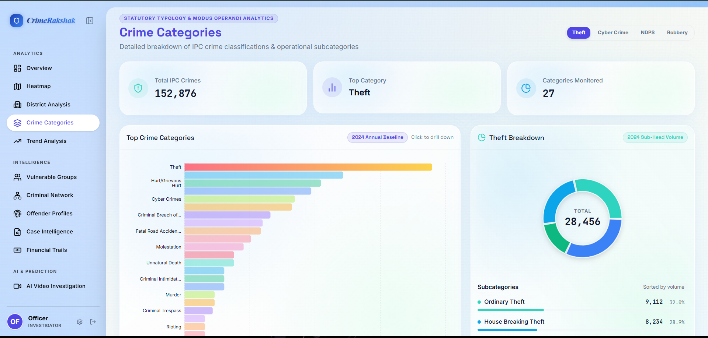

# GEOSENTINEL
## Product Requirements Document (PRD) | Satellite Change Intelligence

**Document status:** Implementation-ready specification, v1.0  
**Prepared:** 25 October 2026  
**Challenge:** ORCA CODER — Problem Statement 05, SpaceTech & Satellite Intelligence  
**Sponsor integration:** Adaption Labs (`https://adaptionlabs.ai/app`)  
**Working product name:** GeoSentinel — renameable by the team  
**Primary implementation:** React + TypeScript frontend; Python + FastAPI geospatial backend  
**Primary audience:** Coding agents, engineering teammates, UI designer, judges  
**Delivery philosophy:** A verifiably working three-hour MVP, then enhancements; never simulate outputs while presenting them as scientific observations.

> **Implementation directive:** Do not create a Streamlit clone. Build a new, responsive, TypeScript-led product that follows the supplied CrimeRakshak screenshot’s **visual language**, not its criminal-justice content. Reuse or adapt only scientifically appropriate implementation ideas from the two specified satellite repositories. The Adaption integration must be a working, observable service call, not a cosmetic sponsor logo.

---

# 1. Executive Summary

GeoSentinel is a browser-based environmental change-intelligence platform for comparing satellite observations over two dates or periods. A user selects a sample case, uploads an aligned pair of images, or—when an online Sentinel-2 data path is available—selects an area and dates. The system calculates verifiable change metrics (NDVI, NDWI, NBR where multispectral bands are present; or general image difference on RGB inputs), marks changed regions, renders geospatial layers and before/after comparisons, and produces a downloadable evidence report.

An **Adaption-powered Incident Intelligence** panel transforms **computed facts** into cautious, structured explanations, possible interpretations, and next-step verification actions. It must explicitly distinguish measured facts from inferred explanations. This makes Adaption a substantive part of the investigative workflow while keeping all spatial computation deterministic and auditable.

**Problem statement as provided in the official 2-page challenge brief:** “Develop an AI-powered satellite anomaly detection system that identifies unusual changes on Earth's surface and distinguishes natural events from potential human-made damage.” Expected examples include forest destruction, coastal changes, unusual land excavation, and infrastructure damage. The 3-hour deliverable includes image upload, before-and-after comparison, highlighted change regions and a simple report. No specialized hardware is required. The brief emphasizes a prototype rather than production completeness.

**Positioning:** “From pixels to evidence: satellite change maps with explainable incident intelligence.”

## 1.1 Outcomes and measurable targets

| Outcome | MVP pass condition | How to demonstrate |
|---|---|---|
| Working change analysis | Two sample or uploaded images yield a deterministic valid change map and numeric summary | Click Run Analysis; show mask and figures |
| Rich visual explanation | Before/after slider, overlay and legend work on the same scene | Toggle layers, drag slider |
| Honest satellite interpretation | Index-specific analyses require proper multispectral bands; incompatible uploads show guidance | Upload RGB and attempt NDVI: disabled + clear explanation |
| Adaption sponsor integration | A real server-side Adaption Responses API request returns a normalized insight, or a visibly labeled provider error | Show API response provenance and new insight generated from measured metrics |
| Report | Export a readable PDF and/or JSON containing method, dates, metrics, uncertainty and sources | Download report; open it |
| Demo resilience | A bundled offline sample case works without satellite-network access | Use Sample Case action |
| UI quality | Dashboard closely follows the screenshot’s hierarchy, spacing, color language and card treatment | Desktop walkthrough + mobile check |

## 1.2 Personas

1. **Environmental analyst:** wants vegetation, flood/water, burn-scar or land-change trends and provenance.
2. **Disaster-response coordinator:** wants severity signals and prioritized areas for review, not unverified emergency declarations.
3. **Researcher / hackathon judge:** wants a transparent workflow, observable computations, screenshots, a fast demo, and an honest account of AI assistance.

## 1.3 Explicit non-goals for the three-hour MVP

- No real-time global monitoring or autonomous emergency dispatch.
- No claim that generic RGB difference is a trained damage classifier.
- No guarantee of detecting *illegal* excavation or attributing cause from two images alone.
- No fabricated model confidence, accuracy, geographic coordinates, field verification, or satellite acquisition metadata.
- No training a custom satellite deep-learning model during the core three-hour build.
- No login, billing, multi-tenant teams, mission scheduling, or continuously updating earth-wide database.

---

# 2. Source-of-Truth and Required Reference Links

Coding agents **must open the links below before adapting algorithms**. Do not assume Python modules can be dropped unchanged into FastAPI; inspect signatures, licenses, dependency constraints, and CRS semantics. The README and source code of these repositories are references, not substitutes for testing.

| Priority | Link | Engineering use | Known limitations / notes |
|---|---|---|---|
| P0 | **Lubna repository:** https://github.com/lubna-ishaq/satellite-change-detection | Scientific satellite workflows: Sentinel-2 L2A retrieval; cloud masking; common grid; composites; NDVI/NDWI/NBR; exports; validation | Requires data access and correct multispectral band semantics; repository MIT licensed |
| P0 | **Lubna `ndvi_core.py`:** https://github.com/lubna-ishaq/satellite-change-detection/blob/main/ndvi_core.py | Index math, masking, change thresholds and area statistics | Inspect how band order and reflectance offsets are handled |
| P0 | **Lubna `data_access.py`:** https://github.com/lubna-ishaq/satellite-change-detection/blob/main/data_access.py | STAC search, image acquisition, matching grids | Live network path may be slower; offline samples mandatory |
| P0 | **Lubna `export.py`:** https://github.com/lubna-ishaq/satellite-change-detection/blob/main/export.py | GeoTIFF / metadata-aware export | Ensure correct CRS, transform and nodata values |
| P0 | **Lubna `validation.py`:** https://github.com/lubna-ishaq/satellite-change-detection/blob/main/validation.py | Reference tests for real environmental change | Reference comparisons are not guarantees on unseen regions |
| P0 | **Birendra repository:** https://github.com/BirendraKSharma/satelite_img_change_detection | General image comparison, overlays, region stats, chart ideas | Primarily Streamlit; frontend MUST be rewritten with TypeScript |
| P0 | **Birendra `change_detector.py`:** https://github.com/BirendraKSharma/satelite_img_change_detection/blob/main/change_detector.py | Threshold, Otsu, change vector detection, connected regions | Verify shared dimensions, bands and alignment before processing |
| P1 | **Birendra `app.py`:** https://github.com/BirendraKSharma/satelite_img_change_detection/blob/main/app.py | UI workflow, chart metrics and image gallery concepts | Behavioral reference only; do not copy Streamlit interface |
| P1 | **Birendra `sample_images/`:** https://github.com/BirendraKSharma/satelite_img_change_detection/tree/main/sample_images | Small pairs for local proof of concept | Check license and provenance; never label samples as new live captures |
| Design-only | **Satquery-Ai:** https://github.com/Ayushnot41/Satquery-Ai | Inspiration for geospatial UI/navigation | Do NOT depend on its purported deep-learning accuracy, seeded index responses or mock segmentation |
| Sponsor P0 | **Adaption app:** https://adaptionlabs.ai/app | Account, API key, datasets and sponsor demo evidence | Access/credits subject to account |
| Sponsor P0 | **Adaption Getting Started:** https://docs.adaptionlabs.ai/introduction/getting-started | Install `adaption`, create secret key | Key remains on Python server only |
| Sponsor P0 | **Adaption Responses API:** https://docs.adaptionlabs.ai/api/python/resources/responses/methods/create | `Adaption().responses.create(...)` implementation | Model availability and credits must be checked at runtime |
| Sponsor P1 | **Invent a Dataset:** https://docs.adaptionlabs.ai/adaptive-data/invent-a-dataset/ | Synthetic incident QA and explanation examples | Dataset jobs are asynchronous; credits/row limits apply |
| Sponsor P1 | **Adaptive Data Quickstart:** https://docs.adaptionlabs.ai/adaptive-data-quickstart | Import/adapt/export curated data | Distinct from the live satellite geospatial processing path |
| Sponsor P1 | **Create a Dataset:** https://docs.adaptionlabs.ai/adaptive-data/create-a-dataset/ | Upload curated `.csv` / `.jsonl` examples | Ground-truth labels need separate validation |
| Data | **Microsoft Planetary Computer:** https://planetarycomputer.microsoft.com/ | Sentinel-2 catalog/STAC source | Must check current availability, rate limits, and terms |
| Data | **STAC spec:** https://stacspec.org/en | Imagery item, asset, date, bbox metadata | Maintain source asset provenance |
| UI | **shadcn/ui + Vite:** https://ui.shadcn.com/docs/installation/vite | Accessible React TypeScript components | Style to reference screenshot |
| UI | **MapLibre GL JS:** https://maplibre.org/maplibre-gl-js/docs/ | Geographic map/layer renderer | Use correct geographic coordinates for overlays |
| UI | **Recharts:** https://recharts.org/en-US/ | Bar, area, time-series, radial charts | Real calculated values only |
| Backend | **FastAPI:** https://fastapi.tiangolo.com/ | Typed API and validation | Keep Python raster processing server-side |
| Geospatial | **Rasterio:** https://rasterio.readthedocs.io/ | Raster load, CRS, alignment, reproject and export | GDAL wheels may be troublesome on Windows |
| Geospatial | **OpenCV:** https://docs.opencv.org/4.x/ | Optional morphological cleanup and contours | Not a replacement for geospatial registration |

**Attribution rule:** Include copyright and original MIT notice for any copied Lubna code. Birendra README describes an MIT license, but a separate license file was not visible in the inspected root listing; **verify the effective permission/notice before copying code**. If unclear, reimplement algorithm ideas independently and credit references in README. Preserve a `THIRD_PARTY_NOTICES.md` and disclose reused or adapted open-source portions to hackathon organizers.

---

# 3. Product Scope and Priority Matrix

**P0 = MUST WORK in submission demo. P1 = build only after P0. P2 = future/stretch.**

| ID | Feature | Priority | Acceptance criterion |
|---|---|---|---|
| FR-01 | Landing/Overview dashboard | P0 | Branded app shell, responsive sidebar, summary cards, active analysis |
| FR-02 | Sample case library | P0 | At least two bundled before/after image pairs; one works offline |
| FR-03 | Upload before/after pair | P0 | PNG/JPEG pair and/or GeoTIFF pair, validated for compatibility |
| FR-04 | Generic image difference | P0 | Deterministic mask using threshold or Otsu; clear legend |
| FR-05 | Before/after slider | P0 | Drag handle, synchronized images, proper aspect ratio |
| FR-06 | Heatmap, regions & overlay | P0 | Display mask, changed pixel count/% and highlighted regions |
| FR-07 | Satellite-specific index | P0 if multispectral sample available | Select NDVI OR NDWI OR NBR and show delta with correct bands |
| FR-08 | Interactive charts & stats | P0 | Affected %, valid coverage, change histogram and regional summary |
| FR-09 | Adaption incident insight | P0 | Backend authenticated request with structured, cautious response |
| FR-10 | Report generation | P0 | Client JSON + print-to-PDF or server generated PDF, with provenance |
| FR-11 | Map view | P1 | Real georeferenced overlay placed in correct geographic location |
| FR-12 | Planetary Computer data search | P1 | AOI, dates, collection and imagery metadata; handle empty cases |
| FR-13 | NDVI + NDWI + NBR modes | P1 | Scientifically correct multi-index processing |
| FR-14 | Adaptive dataset / file search | P1 sponsor | At least one genuine Adaption dataset processing/search step shown |
| FR-15 | Download GeoTIFF, CSV, GeoJSON | P1 | Export contains correct coordinate transform/attributes |
| FR-16 | AI follow-up Q&A | P1 | Evidence-limited analysis questions grounded in last measurement |
| FR-17 | Named region change history | P2 | Persistent studies, multiple dates and workspace history |
| FR-18 | Automated satellite anomaly categorization | P2 | Only after external labeled-data evaluation |
| FR-19 | Specialist infrastructure damage segmentation | P2 | Separate validated model and uncertainty reporting |
| FR-20 | AutoScientist training | P2 | Only if credits, jobs, data and time allow |

**MVP decision gate:** If reliable live Sentinel retrieval or compatible multispectral scenes are unavailable, do not block release. Default to a bundled aligned GeoTIFF pair if present; otherwise deliver working RGB difference and label it **generic image change**. Keep spectral modes visibly disabled until proper input exists.

---

# 4. User Journeys and Exact Interactions

## Journey A: First-time demo (guaranteed offline)

1. Open `/overview` and see a populated but labeled **Sample Case** with summary cards and image thumbnail.
2. Click **Open Sample Case** (e.g., vegetation change); route to `/compare?case=vegetation-demo`.
3. Before/after assets load with scene date and provenance labels; slider starts at 50%.
4. Choose supported analysis method. Any unavailable method shows a disabled state and explanation.
5. Click **Run Analysis**. Show sequence: `validating` → `processing` → `completed`. Display a progress indicator but never fake precise processing progress.
6. Render change overlay, legend, metrics and regions; offer opacity control.
7. Click **Explain with Adaption**. Server sends the actual analysis JSON to Adaption; show `provider=adaption`, generation time and method. If request fails, show provider error and a clearly labeled deterministic summary instead.
8. Click **Export Report**. Verify report matches figures shown and includes data-source / method notes.

## Journey B: Upload pair

1. Drag files onto separate **Before** and **After** targets, or browse locally.
2. Show filename, thumbnail, type, raster dimensions, CRS (if available), timestamp (if metadata exists) and validation.
3. If images differ: for GeoTIFF, offer server alignment/reprojection when possible; for RGB, offer resize for visual demo **with alignment warning**, but disallow confident area measurements.
4. Display selected method options based on available channels.
5. Run; preserve previous results on transient failure, with explicit last-run timestamp.

## Journey C: Search real satellite data (P1)

1. Open `/explorer`; search a named place or draw a bounding box.
2. Set baseline and comparison date ranges (prefer same season) and max cloud fraction.
3. Query STAC via backend, list scenes and metadata; choose scenes.
4. Apply cloud/shadow masking, build median composites on common grid; show available clear observations.
5. Run scientific mode; map results and expose original source URLs and timestamps.

## Journey D: Incident exploration

1. Open a result and switch to **Findings**.
2. Read **Observed Measurements** (numeric facts) distinct from **AI Interpretation** (possible causes).
3. Toggle evidence cards; export report; ask a follow-up limited to measured context (P1).

---

# 5. UI/UX Design System — Reproduce the Reference Visual Language

**Attached screenshot:** `assets/UI_reference_CrimeRakshak.png` (1920 × 918). Use as the style reference, not as an instruction to copy branding, categories, or fictional statistics. Screenshot intentionally follows here in the DOCX version.



## 5.1 Overall appearance

- **Mood:** premium, modern, luminous, calm, restrained; professional earth-observation command center.
- **Surface:** blue-white atmospheric gradient (#DDEEFF → #EFF7FE → #F5FFF9) with extremely low-noise texture; no heavy saturated dashboard background.
- **Sidebar:** full-height light powder-blue rail, desktop width `256px` (collapsed `72px`), fixed or sticky; subtle right border, logo and grouped navigation.
- **Main:** generous 26–34px breathing space around sections; content container `max-width: 1680px` with consistent vertical rhythm.
- **Cards:** opaque/translucent ice-white fills, subtle 1px white border, shadow `0 12px 36px rgba(59,99,143,.09)`, radius `22–28px`.
- **Titles:** soft-indigo/purple headings, dark navy body; avoid huge all-caps on dense data.
- **Accent:** indigo/violet primary CTA, teal/cyan for measured changes, yellow/orange for warnings, red only for true alert/error or negative change legend.
- **Visual treatment:** modest backdrop blur; prioritize text contrast and readability over opacity; avoid thick neon outlines or cartoonish gradients.
- **Motion:** 140–240ms transitions, staggered card reveal allowed, skeleton loaders on data sections; obey `prefers-reduced-motion`.

## 5.2 Design tokens (initial targets, refine by visual QA)

```css
:root {
  --canvas-a: #dcecff;
  --canvas-b: #f4f8ff;
  --canvas-c: #edfcf6;
  --sidebar: #c7defb;
  --surface: rgba(255,255,255,.68);
  --surface-strong: rgba(255,255,255,.86);
  --stroke: rgba(255,255,255,.92);
  --ink: #102543;
  --muted: #5e7491;
  --primary: #5148eb;
  --primary-soft: #e9e7ff;
  --cyan: #08a6dd;
  --teal: #24c7b9;
  --good: #0f9f84;
  --warning: #d79425;
  --danger: #df5874;
  --card-radius: 24px;
  --shadow: 0 14px 38px rgba(59,99,143,.09);
}
```

**Font:** `Inter` for product UI, optionally `Manrope` for headings; local fallback `system-ui, sans-serif`. Labels 12–13px, normal body 14–15px, KPI numerals 25–30px, page title 32–36px. Do not ship tiny 9px labels.

## 5.3 Responsive grid & components

| Breakpoint | Layout | Behavior |
|---|---|---|
| ≥1440px | Desktop sidebar + 12-column content | Three KPI cards; compare chart large left, insights right |
| 1024–1439px | Sidebar + fluid content | 2- or 3-card metrics; main sections adjust |
| 768–1023px | Collapsible rail and 2-column cards | Map/compare retains usable height |
| <768px | Mobile drawer + single-column stack | Slider stays touch-friendly; charts scroll or reflow |

**Required shell:**

- Top brand: satellite/earth icon + **GeoSentinel** wordmark; small status “Geospatial Intelligence”.
- Sidebar groups with icon/label: **Workspace** (Overview, Satellite Explorer, Image Comparison, Change Analysis); **Environmental Intelligence** (Vegetation, Water & Floods, Burn Scars, Change Regions); **Reports & AI** (Adaption Intelligence, Reports, Methodology); Settings/About at bottom.
- Overview header uses small purple eyebrow `EARTH OBSERVATION & CHANGE ANALYTICS`, big title `Satellite Intelligence`, one-sentence explanatory subtitle; right actions `Select Case` and primary `New Analysis`.
- Top KPI cards: `Changed Area`, `Vegetation Delta / Change Index`, `Valid Observation Coverage`, with big numerical results or `—` until analysis. Never populate believable made-up live numbers.
- Large center-left frosted card: **Before / After Comparison**, imagery viewer, draggable slider and layer tabs.
- Center-right card: **Change Breakdown**, compact donut or stacked bar and list of region types (not guessed causal labels).
- Lower row: real **Change Map**, temporal scene detail, histogram and evidence cards.
- Right-side optional insight drawer / card **Adaption Incident Intelligence**, with measured facts first and advisory text second.
- Status chips: **Sample Data**, **Analysis Complete**, **Needs Review**, **AI Explanation**, **Scientific Index**, and **No Geographic Coordinates** (when relevant).

## 5.4 UI behaviors and states

Every data-bearing panel must support `empty`, `loading`, `success`, `partial`, and `error` states. Empty KPI fields use `—`; charts show explanations rather than meaningless placeholders. Spinners disable duplicate submit while allowing cancellation if supported. Success toast must confirm only successful actions. Tooltip legends must explain index delta signs. All controls have hover, focus-visible and keyboard activation.

### Visual anti-requirements

Do not: build a dark or cyberpunk UI; use Streamlit; copy CrimeRakshak logo/content/metrics; use massive hero marketing banners; flood the screen with gradients; place hardcoded statistics in KPI cards; force a map when images lack geolocation; pretend UI actions work without backend wiring.

---

# 6. Navigation, Screens, Detailed Acceptance

## 6.1 Overview `/overview` — P0

Components: page heading; 3 KPI cards; recent/sample case preview; primary compare card; smaller change-category donut; Adaption Insight teaser; recent runs list for current session (not persistent if no database). Initially select a bundled sample case with clearly labeled demo metadata. `New Analysis` launches upload.

## 6.2 Comparison `/compare` — P0

Split header (baseline timestamp left, comparison right); viewer with full-bleed images; accessible `input[type=range]` slider and drag handle; mode toolbar `[RGB][Change Mask][Difference Heatmap][Index Delta]`; opacity slider; image loading/error placeholders; download PNG. Alignment warning banner if resized RGB images. Display the exact algorithm and threshold below viewer.

## 6.3 Change Analysis `/analysis` — P0

Algorithm selector based on modality: `Threshold` and `Otsu` for registered RGB; `CVD` for matching multispectral arrays; `NDVI`, `NDWI`, `NBR` only when required bands available. Threshold control with unit explanation. Changes table with connected region ID, pixel area, geo area if available, centroid (if georeferenced), mean delta, bbox. Legend of positive, negative, unchanged and masked/nodata.

## 6.4 Environmental Analytics `/environment` — P1

Tabs: vegetation; surface water/flood indicators; burn-scar indicators. Each shows baseline index, comparison index, difference and thresholded mask. No automatic flood declaration based only on NDWI: require interpretation label `possible water extent change`. No wildfire claim solely from NBR.

## 6.5 Explorer `/explorer` — P1

MapLibre map; place search; bbox draw control; date range picker; max cloud slider; scene list with provider, collection, acquisition date, cloud estimate; `Fetch + analyze`. Backend transforms displayed bbox EPSG:4326 to suitable raster CRS. Respect geocoder provider policy.

## 6.6 Adaption Intelligence `/intelligence` — P0

Measured facts pane, evidence provenance, summary panel with clearly identified **Adaption response**, suspected explanations, uncertainty, recommended verification, questions for human analyst. Button `Generate with Adaption`. Never label AI inference a scientifically measured fact. A deterministic local summary appears only with a prominent `Fallback: no Adaption inference` banner.

## 6.7 Reports `/reports` — P0

Report preview with project name, region/case, timestamps, methods, bands, thresholds, masks, changed-pixel % and geographic km² only where justified, screenshot/heatmap, AI interpretation, limitation section and original source URLs. Client can print/export PDF through `window.print()` CSS or generate server PDF. JSON download always available.

## 6.8 Methodology `/methodology` — P1

Readable NDVI/NDWI/NBR formulas, what the masks mean, quality warnings, data-source disclosure, caveats, external code acknowledgments, Adaption's role and model status.

---

# 7. Image, Raster and Scientific Processing Specification

## 7.1 Two input modes (critical distinction)

| Mode | Inputs | Permitted methods | Can claim geo-area? |
|---|---|---|---|
| **Visual Pair** | Matched RGB PNG/JPEG or rendered RGB raster | Grayscale/color difference, Otsu, change mask, contour boxes | **No**, unless externally georeferenced with measured pixel area |
| **Scientific Pair** | Georeferenced Sentinel-2 bands / valid multispectral GeoTIFF with known spectral mapping | NDVI, NDWI, NBR, CVD, masks, aligned pixel area | **Yes**, only when CRS/resolution valid and pixel area computation justified |

Never compute NDVI from arbitrary RGB images, invent missing infrared bands, assume filename timestamps equal acquisition dates, or report geographic area from simple pixel count without transform.

## 7.2 Sentinel-2 spectral channel mapping

- `B02 = Blue`, `B03 = Green`, `B04 = Red`, `B08 = Near infrared (NIR)`, `B11 = SWIR1`, `B12 = SWIR2`.
- **NDVI** = `(B08 - B04) / (B08 + B04 + epsilon)`.
- **NDWI (McFeeters open-water indicator)** = `(B03 - B08) / (B03 + B08 + epsilon)`.
- **NBR** = `(B08 - B12) / (B08 + B12 + epsilon)`.
- `Δindex = index_after - index_before`; store sign, masked count, threshold used and interpretation.
- **Resolution issue:** Sentinel-2 band resolutions vary; resample all bands to one target grid using appropriate methods. Never treat 20m SWIR pixels as native 10m observations.
- **Quality:** Mask clouds, shadows, snow and nodata using available SCL/quality data; report clear-observation coverage.
- **Temporal control:** Prefer matching seasons (same month or date window) to limit phenology artifact; note mismatched dates and cloud percentages.

## 7.3 Deterministic core pipeline

1. Validate source type, allowed extension and size; load with explicit errors.
2. Extract shape, channel map, nodata, CRS, transform, timestamp, source IDs and resolution; prevent path traversal.
3. For georeferenced scenes: align on target CRS/resolution/extent and ensure both arrays cover same AOI. For nongeo demo input: require same dimension or perform explicitly warned registration/crop/resizing and mark comparability `approximate`.
4. Construct valid-pixel mask as intersection of both valid images plus cloud mask when available. Keep masked regions visually distinct.
5. Compute requested mode: absolute normalized difference / Otsu / CVD / spectral index deltas.
6. Apply optional noise filtering (small kernel, named threshold) and connected components; never erase small regions without recording settings.
7. Calculate `changed_pixels`, `valid_pixels`, `% changed = 100 * changed_pixels / valid_pixels` (guard `valid_pixels=0`).
8. If projected pixel area valid: `area_km2 = changed_pixels * pixel_area_m2 / 1e6`; use CRS-aware/geodesic method if not uniformly projected.
9. Render RGBA overlay/heatmap and legend using consistent per-class palette; return thumbnails and data paths.
10. Serialize provenance and caveats; save short-lived run state and call Adaption only on explicit user request or configured post-run flow.

## 7.4 Difference & threshold interpretation

- Threshold mode: normalized per-pixel difference with user-set threshold in `[0,1]`.
- Otsu: automatic threshold on valid normalized difference pixels; label threshold value and source.
- CVD: magnitude `sqrt(sum((band_after - band_before)^2))` after radiometric normalization, same bands and registration.
- NDVI decrease can signal vegetation loss/stress; NDWI change indicates surface-water signal change; NBR decrease may indicate burning. **These are indicators, not proven causes**.
- Generic absolute difference can reflect season, illumination, cloud, viewing angle, haze, atmospheric variation, registration or land-cover change.
- A label such as `probable flood` or `damaged building` is **out of scope** without validation model/extra evidence. Classification panel defaults to `unattributed change`.

## 7.5 Mandatory raster quality metadata

`source_provider`, `collection`, `scene_ids`, `sensor`, `acquired_before`, `acquired_after`, `aoi`, `crs`, `transform`, `shape`, `pixel_size_m`, `bands`, `cloud_mask_method`, `valid_pixel_coverage`, `threshold`, `algorithm_version`, `analysis_timestamp`, `data_origin` (`sample`, `upload`, `stac`), `georeferenced`, `warnings`.

---

# 8. Adaption Labs — Sponsor-Grade Functional Integration

**Business rationale:** Use Adaption for domain-specific reasoning, grounded knowledge retrieval, and potentially improved incident-response dataset quality—not to manufacture image measurements. Sponsor integration must be explicitly surfaced in the UI and audit trail.

## 8.1 Minimum qualifying path, must run live (P0)

1. Create an account at `https://adaptionlabs.ai/app`; generate an API key via **Settings → API keys**. Keep it in backend `.env` / hosting secrets only.
2. Install backend SDK: `pip install adaption`. Confirm actual installed SDK and current model availability.
3. Establish backend `AdaptionClient` adapter; `ADAPTION_API_KEY` required for real mode, `ADAPTION_MODEL` configurable.
4. Build a **canonical measurement payload** from completed analysis; include quantitative values, data provenance and warnings; never send invented results.
5. Call `Adaption().responses.create(model=..., input=..., instructions=..., max_output_tokens=..., temperature=0, store=False)` server-side. The documented interface also supports dataset-grounded `tools=[{"type":"file_search","dataset_ids":[...]}]` when authorized.
6. Normalize provider response into validated JSON. If the model did not produce valid JSON, safely parse/retry once or show raw as a clearly labeled advisory; no fake successful inference.
7. Persist only necessary analysis/session metadata; display `Provider: Adaption`, `Model: {actual model}`, `Generated at`, request status and optional **Dataset ID**. Show a distinct banner if provider unavailable.
8. Provide a screenshot or short on-stage API log proof **with keys hidden**.

## 8.2 Exact input payload contract (example, measured fields are illustrative)

```json
{
  "analysis_id": "ana_2026_001",
  "mode": "scientific",
  "index": "NDVI",
  "baseline_time": "2021-08-01",
  "comparison_time": "2024-08-01",
  "changed_pixels": 24000,
  "valid_pixels": 100000,
  "change_percentage": 24.0,
  "mean_index_before": 0.66,
  "mean_index_after": 0.39,
  "mean_delta": -0.27,
  "affected_area_km2": 2.4,
  "cloud_free_coverage": 0.91,
  "data_origin": "sample",
  "warnings": ["Synthetic example metrics - not a real observation"]
}
```

**Important:** Values above are deliberately invented **contract examples**, never preload them into a live result card. The P0 app must send values from the actual selected analysis; use provider-ready fixtures only in tests.

## 8.3 System prompt and output structure

```text
ROLE: Satellite incident analyst assistant for a scientific dashboard.
INPUT: Trusted JSON metrics computed by our raster pipeline.
REQUIREMENTS:
- Use only numbers provided. Do not fabricate causes, dates, coordinates or confidence.
- State what was measured, then give 1-3 plausible interpretations as hypotheses.
- Explain at least two confounders (clouds, seasonal variation, registration etc.) when relevant.
- Recommend practical external verification checks.
- If measurement is RGB-only, never claim measured NDVI, NDWI, NBR or km².
- Return JSON object with keys: summary, observations[], possible_explanations[],
  caveats[], verification_steps[], review_priority, evidence_used[].
- review_priority is one of low, medium, high, insufficient_evidence;
  it is an operational triage suggestion, not statistically calibrated accuracy.
```

## 8.4 Python SDK implementation reference (illustrative and documented signatures)

```python
# backend/app/services/adaption_service.py
import json
import os
from adaption import Adaption

SYSTEM_INSTRUCTIONS = (
    "Interpret only computed satellite measurements. "
    "Return JSON containing summary, observations, "
    "possible_explanations, caveats, verification_steps, "
    "review_priority, evidence_used. Do not invent evidence. "
    "Treat causes as unverified hypotheses."
)

def explain_measurements(analysis: dict) -> dict:
    if not os.getenv("ADAPTION_API_KEY"):
        raise RuntimeError("Adaption not configured")
    client = Adaption()
    kwargs = {
        "model": os.getenv("ADAPTION_MODEL", "qwen3.5-397b"),
        "input": json.dumps(analysis),
        "instructions": SYSTEM_INSTRUCTIONS,
        "max_output_tokens": 800,
        "temperature": 0,
        "store": False,
    }
    dataset_id = os.getenv("ADAPTION_DATASET_ID")
    if dataset_id:
        kwargs["tools"] = [{"type": "file_search", "dataset_ids": [dataset_id]}]
    response = client.responses.create(**kwargs)
    # IMPLEMENT: inspect typed response.output items, collect message text,
    # JSON-decode, and validate with Pydantic. Do NOT assume response is a plain string.
    return {"provider": "adaption", "raw_response": response}
```

The above function intentionally leaves **SDK typed-response normalization** to an adapter with tests, because inference providers may return structured output items rather than a raw JSON string. Do not return this raw SDK object directly from a FastAPI route; convert to the schema below. Verify model access and documented SDK API against live account before the demo.

## 8.5 Optional sponsor differentiator: Adaptive Incident Playbook (P1)

Build a curated incident-response playbook dataset with a small collection of **reviewed**, non-fabricated instructions: e.g. how to interpret NDVI drop with seasonal caveat, water loss with baseline water mask, NBR decrease after burning, and nongeoreferenced RGB limitations. Use Adaption dataset ingestion (`datasets.upload_file(...)`) and `datasets.adapt(...)` following current docs. If credits/time allow, run `datasets.invent(...)` to expand **synthetic instruction** examples; record `dataset_id`, row count, status, validation notes and credits. Use file-search grounding via `tools` in Responses API when the adapted dataset is actually authorized. Give each resulting recommendation a traceable supporting playbook row or `no supporting row` label.

**Do not** claim an invented dataset is real labeled satellite imagery or that the image detector was trained on it. Save dataset-processing evidence in `docs/adaption-evidence.md` (redacted screenshots, job ID, dataset schema, provider call trace, short cost note). Dataset generation can take longer than the hackathon period; preflight it as soon as credentials become available.

## 8.6 User-visible Adaption UX requirements

- Status: `Not configured`, `Ready`, `Generating`, `Completed`, `Unavailable`, `Grounded dataset unavailable`.
- Provenance label for every paragraph: `Computed fact` / `Adaption hypothesis` / `Suggested check`.
- A button to regenerate for the current analysis; disable if analysis changed or key unavailable.
- Show non-sensitive request ID/model/date where provided; don't show API key, internal stack secrets or full credentials.
- Rate-limit per session; retries exponential backoff for 429/5xx; soft-fail after timeout; never block images and metrics.
- Optional `Evidence` drawer showing exact JSON given to Adaption.
- Model cannot write detection masks, area values, alerts or scene metadata.

## 8.7 Backend normalized AI output

```ts
type IncidentInsight = {
  provider: "adaption" | "local_fallback";
  model?: string;
  analysisId: string;
  generatedAt: string;
  summary: string;
  observations: string[];
  possibleExplanations: string[];
  caveats: string[];
  verificationSteps: string[];
  reviewPriority: "low" | "medium" | "high" | "insufficient_evidence";
  evidenceUsed: string[];
  groundedDatasetId?: string | null;
  providerStatus: "success" | "fallback" | "error";
};
```

---

# 9. Technical Architecture

## 9.1 High-level diagram

```text
Browser (React / Vite / TypeScript)
  ├── AppShell + Overview + Compare + Analysis + Reports
  ├── shadcn/ui + Tailwind + Motion + Recharts + MapLibre
  ├── TanStack Query (async server state) + Zod (response validation)
  └── /api client
             │ HTTPS / JSON / multipart
             ▼
FastAPI / Python backend
  ├── Router: upload, samples, analysis, imagery, insights, reports
  ├── Pydantic schemas + job state + errors
  ├── raster_io.py       → load, align, CRS, nodata, cloud mask
  ├── change_methods.py  → threshold, Otsu, CVD, NDVI/NDWI/NBR
  ├── region_stats.py    → masks, connected components, summaries
  ├── imagery_stac.py    → Planetary Computer / Sentinel-2 (P1)
  ├── render_outputs.py  → PNG masks/tiles/plots/GeoTIFF
  ├── adaption_service.py→ Adaption inference + optional dataset search
  └── report_service.py  → JSON + HTML/PDF + provenance
             │
             ├── short-lived local cache (uploads/runs, temp dir)
             ├── external STAC / remote raster objects (P1)
             └── Adaption API (optional / sponsor)
```

## 9.2 Stack and rationale

| Domain | Choice | Why |
|---|---|---|
| Web | React 18+ or current compatible release, Vite, strict TypeScript | Fast local DX; scalable component tree |
| CSS | Tailwind CSS + shadcn/ui + CSS variables | Precise screenshot-driven visual system; accessible primitives |
| Charts | Recharts | Flexible dashboards and drilldowns |
| Motion | Motion React | Subtle transitions, skeletons, panel entrance |
| Mapping | MapLibre GL JS + optionally PMTiles/GeoJSON | Avoid mandatory paid map platform |
| State | TanStack Query for API; lightweight React Context/Zustand if needed | Reliable async states without giant Redux boilerplate |
| Forms | React Hook Form + Zod | Typed validation and file form flows |
| Backend | Python 3.11/3.12 + FastAPI + Pydantic | Mature scientific ecosystem |
| Raster processing | NumPy, Rasterio, OpenCV (optional), Pillow | Index math, reprojection, comparison and visual layers |
| Online remote-sensing | `pystac-client`, `planetary-computer`, `odc-stac`, `odc-geo` | Matches Lubna implementation and Sentinel L2A STAC flow |
| Sponsor inference | Official Python `adaption` SDK | Real sponsor call and future dataset integration |
| Reporting | HTML print/PDF via browser for P0, ReportLab optional backend | Fastest credible export |
| Storage | In-memory job manifest + filesystem temp assets for MVP | Avoid unnecessary DB setup; TTL cleanup |
| Testing | pytest + Vitest + React Testing Library + Playwright smoke | Algorithm validation and UI flow coverage |
| Deploy | Frontend Vercel/Netlify; backend Render/Railway/compatible host | Feasible if dependency builds and secrets configured |

**Known deployment constraint:** Rasterio/GDAL, STAC and model dependencies can exhaust small free hosting plans. Prefer small sample rasters, pin versions, cache thumbnails, limit scenes, and avoid heavy startup processing. For live judging, a verified localhost demo with a reliable backup is preferable to an unavailable production URL.

## 9.3 Expected monorepo structure

```text
geosentinel/
├── README.md
├── LICENSE / THIRD_PARTY_NOTICES.md
├── .gitignore
├── docs/
│   ├── PRD.md                    # this document
│   ├── architecture.md
│   ├── scientific-methodology.md
│   ├── adaption-evidence.md
│   ├── test-report.md
│   └── assets/UI_reference_CrimeRakshak.png
├── frontend/
│   ├── package.json
│   ├── index.html
│   ├── src/
│   │   ├── app/{App.tsx,routes.tsx,providers.tsx}
│   │   ├── components/{AppShell,Sidebar,TopBar,KpiCard,StatusBadge}/
│   │   ├── features/{samples,upload,comparison,analysis,map,insights,reports}/
│   │   ├── pages/{Overview,Comparison,Analysis,Explorer,Intelligence,Reports}/
│   │   ├── lib/{api.ts,types.ts,format.ts,validation.ts}
│   │   ├── styles/{globals.css,tokens.css}
│   │   └── assets/
│   └── .env.example
├── backend/
│   ├── pyproject.toml or requirements.txt
│   ├── .env.example
│   ├── app/
│   │   ├── main.py
│   │   ├── api/{health.py,samples.py,uploads.py,analysis.py,insights.py,reports.py,imagery.py}
│   │   ├── schemas/{analysis.py,insights.py,reports.py}
│   │   ├── services/{raster_io.py,change_methods.py,region_stats.py,imagery_stac.py,adaption_service.py,report_service.py}
│   │   ├── core/{config.py,security.py,errors.py}
│   │   └── static/generated/
│   └── tests/{test_indices.py,test_alignment.py,test_analysis.py,test_adaption.py,test_api.py}
├── samples/
│   ├── manifest.json
│   ├── vegetation-demo/{before.png,after.png,metadata.json}
│   └── rgb-change-demo/{before.png,after.png,metadata.json}
└── scripts/{smoke-test.sh,seed-samples.py}
```

---

# 10. API Contract and Errors

Base URL configurable via `VITE_API_BASE_URL`; prefix API version `/api/v1`. JSON uses camelCase on frontend, snake_case on Python internals with explicit alias conversions. All objects have stable IDs and provenance. Endpoints below are **proposed application API**, not endpoints from external repos.

| Method | Path | Priority | Behavior |
|---|---|---|---|
| GET | `/api/v1/health` | P0 | Backend `ok`, app version, `adaptionConfigured` boolean; no key |
| GET | `/api/v1/samples` | P0 | Available sample cases, thumbnails, modality, valid methods |
| POST | `/api/v1/uploads/pair` | P0 | multipart `before`, `after`, optional metadata; returns pairId and compatibility |
| POST | `/api/v1/analyses` | P0 | `pairId/sampleId`, method, threshold, params; returns `analysisId/status` |
| GET | `/api/v1/analyses/{id}` | P0 | Status and completed measurements/metadata/asset URLs |
| GET | `/api/v1/analyses/{id}/overlay.png` | P0 | Generated image; cache headers appropriate |
| POST | `/api/v1/analyses/{id}/insights` | P0 | Calls Adaption; returns normalized `IncidentInsight` |
| GET | `/api/v1/analyses/{id}/report.json` | P0 | Complete report data and source citations |
| GET | `/api/v1/analyses/{id}/report.pdf` | P1 | Server-generated PDF (P0 may use browser print) |
| GET | `/api/v1/imagery/search?...` | P1 | Query real Sentinel-2 STAC via backend |
| GET | `/api/v1/analyses/{id}/regions.geojson` | P1 | Georeferenced region polygons only |
| GET | `/api/v1/analyses/{id}/result.tif` | P1 | Georeferenced scientific export |

### Proposed analysis request

```json
{
  "source": {"sampleId": "vegetation-demo"},
  "method": "ndvi",
  "threshold": 0.15,
  "parameters": {"minRegionPixels": 20, "smoothingKernel": 3}
}
```

### Proposed analysis response

```json
{
  "analysisId": "ana_demo_001",
  "status": "completed",
  "mode": "scientific",
  "method": "ndvi",
  "measurements": {
    "changedPixels": 1234,
    "validPixels": 5678,
    "changePercentage": 21.73,
    "affectedAreaKm2": null,
    "meanDelta": -0.12,
    "coverageFraction": 0.92
  },
  "visuals": {"beforeUrl": "/assets/...", "afterUrl": "/assets/...", "overlayUrl": "/assets/..."},
  "provenance": {"origin": "sample", "crs": null, "sourceSceneIds": []},
  "warnings": ["Sample metrics are representative placeholders in this contract"]
}
```

JSON above is schema illustration only; actual app must calculate numeric values and asset paths for the selected case.

### Error object

```json
{
  "error": {
    "code": "INCOMPATIBLE_BANDS",
    "message": "NDVI requires red and NIR channels with a known band map.",
    "details": {"required": ["B04", "B08"]},
    "retryable": false
  }
}
```

Error codes: `MISSING_FILE`, `UNSUPPORTED_FORMAT`, `FILE_TOO_LARGE`, `INCOMPATIBLE_BANDS`, `DIMENSION_MISMATCH`, `CRS_MISMATCH`, `NO_VALID_PIXELS`, `NO_SCENES_FOUND`, `IMAGERY_PROVIDER_TIMEOUT`, `INVALID_METHOD`, `NOT_FOUND`, `ADAPTION_NOT_CONFIGURED`, `ADAPTION_TIMEOUT`, `ADAPTION_PROVIDER_ERROR`, `INTERNAL_ERROR`.

---

# 11. Data Models and Persistence

**Analysis record:** `id`, `createdAt`, `source`, `mode`, `method`, `parameters`, `status`, `progressStage`, `inputFileIds`, `sourceMetadata`, `measurements`, `regions`, `warnings`, `assets`, `error`, `algorithmVersion`, `insights`.

**Sample manifest:** `id`, `title`, `description`, `type`, `beforePath`, `afterPath`, `acquiredBefore?`, `acquiredAfter?`, `geoTransform?`, `crs?`, `bandMap?`, `credit`, `license`, `isSynthetic`, `expectedMethods`, `knownLimitations`.

**Region:** `id`, `maskPixelCount`, `bboxPixels`, `centroidPixels`, `areaKm2?`, `bboxGeo?`, `meanDelta?`, `geometryGeoJSON?` (GeoJSON only when georeferenced).

**No hard database for MVP.** Use a temp directory per analysis, bounded size and TTL (e.g., remove uploads after 60 minutes); stable sample assets committed. Frontend persists only nonsecret selected sample ID in URL. For production future, add Postgres/PostGIS and object storage separately.

---

# 12. Upload Validation, Security, Privacy and Safety

- P0 file types PNG, JPEG; GeoTIFF supported only when raster backend ready. Detect MIME by content, not file extension alone.
- Guard file limits (suggested 20 MB/image, configurable), image dimensions (e.g., max 4096px each for RGB), oversized decompression bombs, malformed TIFF and archive/path traversal. No archives in upload route.
- Sanitize display names; generate internal UUID filenames; never execute uploaded content.
- Same-origin CORS in production; explicit permitted local frontend origin in development.
- API key hidden server-side; never put `ADAPTION_API_KEY` or Planetary Computer signed URLs into public logs/screenshots.
- Rate-limit insight generation and uploads per IP/session; sane backend timeouts and bounded concurrency.
- Avoid sending actual raw images to Adaption unless supported and intentionally configured; P0 sends measured JSON only.
- Collect no personally identifying information. Delete temp uploads by TTL and avoid persistent logging of image content.
- Use appropriate map tiles, geocoding provider policies and source attributions.
- Scientific warning: visualizations support decision-making, not emergency response without field verification.
- Accessibility: keyboard controls for slider and navigation, color-blind-safe status distinction beyond hue, ARIA labels for charts and icons, contrast ~4.5:1 for normal text, reduced-motion support.

---

# 13. Performance and Reliability Requirements

| Metric | P0 target | Notes |
|---|---|---|
| First meaningful UI | ~2.5 seconds on demo laptop (cached) | Avoid bloated map bundle on initial route |
| Sample load | 1–3 seconds local | Precompute thumbnail assets |
| Core RGB pair analysis | Aim under 10 seconds for 1024² sample | Actual timing must be measured; no fabricated benchmark |
| AI incident response | Client timeout around 20–30 seconds | Provider latency may vary; use backoff on retryable errors |
| UI interactions | ~60fps for 1024px slider | Render native CSS clipping; don't recompute analysis on drag |
| Large samples | Limit and downsample or reject cleanly | Disclose resolution and quality impact |
| Accessibility | Full keyboard operation on P0 routes | Include smoke test |
| Fallback | Scientific result still visible with Adaption offline | Clear provider status |
| Reproducibility | Same file + method + threshold yields same metrics | Excludes external provider natural-language variability |

Use trace IDs and scrubbed logs to diagnose network and scientific errors. Never claim a method was run until the backend returned a completed response.

---

# 14. Test Strategy and Acceptance Test Cases

**Core scientific unit tests**

- `NDVI`: identical red/NIR arrays result expected values; masked zero denominator produces nodata rather than NaN.
- `NDWI`: correct Green and NIR band selection.
- `NBR`: SWIR2 used, not SWIR1; sign of before/after delta verified.
- `Alignment`: mismatched raster transform/CRS does not silently pair raw pixels; reprojection is explicit.
- `Mask`: clouds/nodata excluded from denominator and overlay.
- `Area`: known projected 10m pixels calculate 0.0001 km² per valid pixel; no `areaKm2` when CRS unknown.
- `No change`: identical image pair yields 0 changed pixels under positive threshold.
- `Synthetic change`: known colored rectangle appears in detected mask; bbox approximately matches fixture.
- `Missing bands`: RGB file cannot run NDVI and returns expected error.
- `No valid pixels`: returns error, not divide-by-zero or a fictitious 0% change.
- `Determinism`: same pixels/params give same output hash/metrics.

**API tests**

- `GET /health` never leaks API key.
- Valid sample analysis returns success and all asset URLs resolve.
- Bad upload returns 4xx with structured errors.
- Adaption absent returns `ADAPTION_NOT_CONFIGURED` (not a fake provider response).
- Mock Adaption timeout returns retryable error, allows deterministic local text fallback distinctly labeled.
- Report matches analysis metrics exactly and discloses sample provenance.

**Frontend tests**

- Responsive sidebar, keyboard focus, mobile navigation, slider at 0/50/100%.
- Start an analysis twice does not create accidental duplicate runs.
- Empty KPI placeholder never shows hardcoded numbers.
- Error toast reflects backend error; failed API request never shows `success` chip.
- Adaption status marks source correctly.
- Open sample → run → compare → generate insight → export flow passes Playwright smoke on desktop viewport.

**Manual scientific review checklist**

1. Exact acquisition dates shown if known, not guessed.
2. Source imagery credited; valid pixels & cloud mask reported.
3. Any registration/season mismatch prominently warned.
4. Index formula correct; color legend and sign unambiguous.
5. AI caveats cannot be mistaken for detector certainty.

---

# 15. Development Plan — 3-Hour Hackathon

This is a **priority order**, not a guarantee that the entire P0 can be implemented within three hours. Begin with known-working samples and time-box risky operations.

| Window | Engineering work | Exit condition |
|---|---|---|
| 0–20 min | Repo scaffold; backend health route; frontend shell; secrets check; place screenshot in docs | App launches; both servers reachable |
| 20–55 min | Implement / adapt one deterministic detector; add 2 sample pairs; validated API | Sample run creates real mask/metrics |
| 55–95 min | Complete screenshot-inspired Overview + Comparison + sidebar; KPI cards; charts | End-to-end sample demo is visually credible |
| 95–125 min | Adaption Responses call, normalized insight, fallback, provider badge | Real sponsor inference demonstrable |
| 125–145 min | Report HTML/JSON + print-to-PDF; provenance/attribution | Report downloads correctly |
| 145–165 min | Test all navigation, errors, phone + desktop; screenshots | No demo blockers |
| 165–180 min | README, disclosure, pitch and backup demo video/screenshot | Live demo + fail-safe ready |

**Fastest P0 scientific decision:** If multispectral pairs aren't immediately available, prioritize a high-quality RGB change engine and honest uncertainty labeling. If a sample multispectral pair is ready, start with NDVI or NDWI, not all three indices. Add STAC online retrieval and remaining indices after a reliable P0.

## 15.1 Build dependencies/order

`Backend sample loader → deterministic mask → typed API → compare viewer → real KPIs → Adaption call → report → polish → optional STAC & datasets.`

No work on exotic AI models, authentication, billing or deployment animations until this path works.

## 15.2 Delegation to a coding agent

- **Agent A (Backend scientific):** Scientific loader, deterministic method, tests, API schemas.
- **Agent B (UI):** Screenshot-matched responsive shell, comparison, charts, loading states.
- **Agent C (Sponsor/report):** Adaption real call, data-contract validation, report and evidence file.
- **Integrator:** merges on contract-defined JSON, runs smoke tests, detects false metrics and checks open-source notices.

---

# 16. Demo Sequence and Judge Narrative

**Ideal 3-minute demo**

1. (0:00–0:20) Problem: environmental changes are hard to assess quickly from raw imagery. Reveal the premium GeoSentinel Overview.
2. (0:20–0:55) Select bundled documented vegetation or coastal case, show source and dates, drag before/after comparison.
3. (0:55–1:30) Run scientific or generic analysis; show transparent method, overlay and genuine changed-pixel/area metrics.
4. (1:30–2:15) Click **Explain with Adaption**; show the actual request provenance, result summary, limitations, and recommended checks. If retrieval-enabled, show playbook evidence.
5. (2:15–2:40) Export report with charts, metrics, method and source links.
6. (2:40–3:00) Close with why combining transparent geospatial measurements, usable visualization and an Adaption-grounded intelligence layer matters. Clearly state remaining limitations.

**Extra prize framing:** The sponsor model consumes a verified measurement schema, supports domain-specific environmental reasoning, and optionally retrieves an Adaption-adapted incident playbook. Do not claim the satellite detector itself was trained by Adaption unless that really occurred.

## 16.1 Presentation proof checklist

- Live call or captured console trace demonstrates Adaption's API endpoint and nonempty real response.
- No API keys in screenshares.
- One slide showing P0 data flow and exactly which component uses Adaption.
- One slide or appendix with reused-repository acknowledgements and measurable innovations.
- Show fallback behavior honestly if provider is down.

---

# 17. Risks, Mitigations and Escalations

| Risk | Impact | Mitigation |
|---|---|---|
| Clouded/missing Sentinel scenes | Inaccurate or empty imagery | Bundle offline pair; cloud mask; coverage warnings; seasonal windows |
| GeoTIFF dependency install on Windows | Broken backend | Pin Python 3.11/3.12, wheels; test env early; use Docker only if already ready |
| Mixed CRS or band resolutions | False change | Reproject/align explicitly; validate array/band metadata; unit tests |
| RGB comparison mistaken for disaster cause | Misleading demo | Show `generic visual difference` and clear limitations |
| Adaption credentials/credits missing | Sponsor path unusable | Get key at start, execute a trivial real call early; transparent disabled badge if unavailable |
| Dataset invention/adaptation takes too long | Wasted time | Treat dataset RAG as P1; core Responses first |
| UI over-polish before backend | Beautiful nonfunctional prototype | Strict P0 exit conditions and test per milestone |
| Output falsely shows km² | Scientific credibility risk | Require projected CRS and verified transform |
| Third-party licensing unclear | Compliance risk | Include notices/README disclosure; avoid direct code copying when uncertain |
| API unavailable during demo | Live failure | Offline sample, cached raster outputs only if labeled, controlled video backup |

---

# 18. Definition of Done

**The project is demo-ready only when ALL these statements are true:**

- [ ] Frontend and backend both launch from README steps with a clean install.
- [ ] Visual design closely reflects supplied screenshot in palette, sidebar, translucency, radius and layout.
- [ ] One sample case loads fully offline, and uploads have correct validation.
- [ ] A real deterministic algorithm produces an overlay and statistically consistent change percentages.
- [ ] For spectral indices, actual multispectral bands are present; otherwise the feature is disabled or labeled preview.
- [ ] No live KPI, AI confidence or geospatial area is invented/hardcoded.
- [ ] Adaption-backed insight is genuinely called from the backend and provider status is truthful; if unavailable, no fake completion.
- [ ] Exported report includes analysis metadata and limits.
- [ ] Changed region descriptions are not falsely asserted as illegal activity or damage.
- [ ] 10 scientific/API checks and main UI smoke test pass (or failures are documented).
- [ ] README credits sources and discloses adapted code, generated content and key limitations.
- [ ] Demo walkthrough fits roughly three minutes; fallback paths tested.

---

# 19. `.env.example` and Local Setup Requirements

### Backend `backend/.env.example`

```dotenv
APP_ENV=development
API_PREFIX=/api/v1
ALLOWED_ORIGINS=http://localhost:5173
UPLOAD_MAX_MB=20
TEMP_DATA_DIR=./.cache/geosentinel
ADAPTION_API_KEY=
ADAPTION_MODEL=qwen3.5-397b
ADAPTION_DATASET_ID=
ADAPTION_TIMEOUT_SECONDS=25
PLANETARY_COMPUTER_ENABLED=false
```

### Frontend `frontend/.env.example`

```dotenv
VITE_API_BASE_URL=http://localhost:8000/api/v1
VITE_DEFAULT_SAMPLE_ID=rgb-change-demo
```

**Agent setup checklist:** `python -m venv .venv`; activate env; install pinned backend requirements; `uvicorn app.main:app --reload --port 8000`; in `frontend` run `npm install` then `npm run dev`. If external components require a key, document it and ensure core sample demo still works. Do not add a speculative `GEMINI_API_KEY` when Adaption is the chosen intelligence provider.

---

# 20. Additional Technical Acceptance Rules for an Autonomous Agent

1. **Implement, don't imply.** Every visible CTA must be wired to a route/action or clearly disabled. No simulated dashboards masquerading as working features.
2. **Input-dependent UI.** KPI values, charts, status and report all derive from the same `AnalysisResult` object; never duplicate numeric constants across components.
3. **One canonical API schema.** Generate or mirror TypeScript types from Pydantic/OpenAPI, avoid manually drifting field names.
4. **Separate computation from inference.** Adaption cannot edit `measurements` or `metadata`; store its output separately as `insight`.
5. **Zero unverified model-accuracy claims.** Avoid claiming 95–99% accuracy or trained segmentation without reproducible evaluation.
6. **Actual scientific citations and source provenance.** Add satellite scene/provider and method references to report.
7. **Fast smoke test after each milestone.** Run `curl /health`, local sample analyze, overlay GET, Adaption mock/live and export route checks.
8. **Respect third-party licenses.** Inspect linked repository code and any upstream dependencies; maintain legal notices.
9. **No GUI-only state.** User can refresh a completed analysis during its TTL and result URLs remain valid.
10. **Safe failure.** Bad image, empty mask, offline key, cloudy scene or provider timeout generates precise UI error instead of blank panels.
11. **Visual QA.** Compare screenshot at desktop 1920×918 and at mobile 390×844; sidebar, padding, card radius and typography should resemble design tokens above.
12. **No silent scope inflation.** P1/P2 feature placeholders should not appear as working features without tests.
13. **Version and provenance.** Store detector algorithm version, threshold, source file identifiers and SDK model string in result/report.
14. **No model weights fabricated.** A network with randomly initialized weights is not a trained anomaly detector.
15. **Build a polished, honest prototype**, then advance into real-time/specialist models when resources permit.

---

# 21. Final Resource Index & Research Notes

**Confirmed in public repository docs during preparation (25 Oct 2026):** Lubna repository describes Sentinel-2 L2A ingestion, cloud masking, season-composited imagery, NDVI/NDWI/NBR and GeoTIFF export; it reports 176 offline tests and MIT licensing. Birendra repository describes configurable threshold/Otsu/CVD/NDVI change detectors, a Streamlit dashboard, visual metrics and optional Gemini summaries. Their source files are linked in §2. The new UI will be a distinct React/TypeScript implementation. Adaption official docs describe SDK (`pip install adaption`), `responses.create`, `datasets.invent`, dataset upload and optional retrieval via `file_search`. **Their operation in this team's account requires live credential/credit verification.**

**Sources (original documentation and repositories):**

1. PS 05 supplied ORCA CODER challenge PDF (2 pages; user-provided).
2. UI screenshot supplied by the team (CrimeRakshak analytics interface, used for design reference only).
3. https://github.com/lubna-ishaq/satellite-change-detection
4. https://github.com/lubna-ishaq/satellite-change-detection/blob/main/LICENSE
5. https://github.com/BirendraKSharma/satelite_img_change_detection
6. https://docs.adaptionlabs.ai/introduction/getting-started
7. https://docs.adaptionlabs.ai/api/python/resources/responses/methods/create
8. https://docs.adaptionlabs.ai/adaptive-data/invent-a-dataset/
9. https://docs.adaptionlabs.ai/adaptive-data/create-a-dataset/
10. https://docs.adaptionlabs.ai/adaptive-data-quickstart
11. https://planetarycomputer.microsoft.com/
12. https://stacspec.org/en
13. https://ui.shadcn.com/docs/installation/vite
14. https://maplibre.org/maplibre-gl-js/docs/
15. https://fastapi.tiangolo.com/
16. https://rasterio.readthedocs.io/

---

## Final Agent Prompt (copy into coding agent)

> **Build GeoSentinel exactly according to this PRD, in strict P0-first order.** Read the two linked GitHub repositories and Adaption's official SDK documentation before implementing algorithms or sponsor calls. Create a React + TypeScript + Vite + Tailwind + shadcn/ui frontend and Python + FastAPI raster-analysis backend; reproduce the design language of `assets/UI_reference_CrimeRakshak.png` without copying its brand or content. Implement true before/after upload/sample comparison, a working mask and quantified metrics, an interactive overlay/slider, a server-side real Adaption response with truthful provider status, and downloadable report. Use Sentinel-2 NDVI/NDWI/NBR only with valid spectral data and aligned grids. Never hardcode measured stats, fabricate damage labels/model confidence, or portray mock Adaption responses as live. Include tests, warnings, sources, repo attribution and setup commands. Prove the entire P0 journey works before extending to P1. The project should look premium but every visible data feature must be functional.
